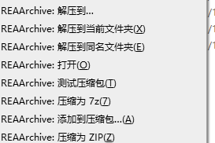
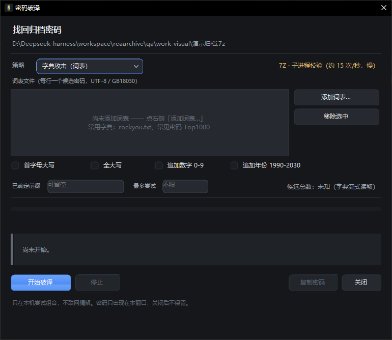
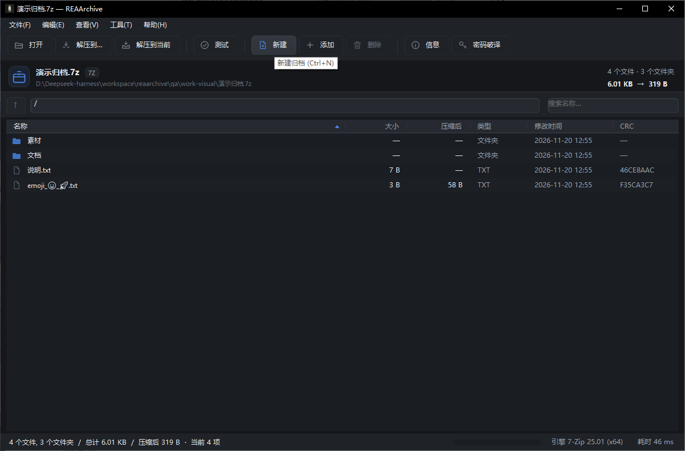

# REAArchive — 纯净压缩

> 一个**不联网、不检查更新、无广告、无遥测**的 Windows 压缩/解压软件。
> 归档能力来自随包的 **7-Zip 25.01** 引擎（LGPL）；界面、交互、安全防护为本项目原创实现。

[]() [%20%2B%20LGPL%20(7--Zip)-yellow)]()

## 为什么做它

这类工具的标准版往往靠广告、升级检查与后台联网变现：更新器常驻、界面留广告位、运行时上报统计。REAArchive 的做法是从架构上把这三类东西直接去掉：

- 不链接任何网络库，不可联网
- 不打包更新器，不检查新版本
- 不内置广告位与推广入口
- 不写自启项、不收集遥测

归档能力使用 **7-Zip 官方引擎**（LGPL，随包分发），界面与交互全部自行实现。


## 功能

| 类别 | 内容 |
|---|---|
| **打开/浏览** | 7z / zip / rar（只读）/ tar / gz / tgz / bz2 / xz / iso / wim；目录树双击进入、路径栏回上级、按列排序、搜索过滤 |
| **解压** | 解压到…（目标目录、覆盖/跳过/重命名、密码）、解压到当前文件夹、只解选中项、完成后打开文件夹 |
| **压缩** | 新建 7z/zip/tar/gz/bz2/xz；压缩级别 0/1/5/7/9；密码；7z 连文件名加密；分卷大小；向已有归档**追加**；**删除**归档内条目 |
| **校验** | 完整性测试（7z t）、CRC 列显示 |
| **密码破译** | 忘记自己归档的密码时，**本机离线**用字典 / 掩码 / 增量三种策略找回；zip 走进程内校验（约 50 万次/秒），其他格式走 7z 子进程预言机（约 15 次/秒）；找到后可一键用于解压 |
| **安全** | 解压前拦截目录穿越（`..\`、绝对路径、NTFS ADS）、非法字符消毒、>240 字符长路径 `\\?\`、密码不落日志 |
| **性能** | 全部异步、可取消；解压走原生 7-Zip 引擎；大归档列表虚拟化、不阻塞 UI |
| **界面** | 深色主题全部自绘（工具栏 / 输入框 / 下拉 / 复选 / 进度条 / 列表），26px 行高、悬停行、选中竖条、表头排序列、文件类型图标、空态插画；图标为 GDI+ 手绘，不加载任何图片资源 |
| **命令行** | `REAArchive.exe <archive>` 打开；`-e <archive> <dest>` 解压后退出；`-l <archive>` 列表输出（供自动化） |
| **外壳** | 右键菜单（HKCU，可逆，默认不装——本次已装）：解压到当前文件夹 / 解压到同名文件夹 / 解压到… / 打开 / 测试；文件与文件夹右键：压缩为 7z / 压缩为 ZIP / 添加到压缩包…；文件夹空白处右键：压缩此文件夹；另注册 `REAArchive.Archive` ProgID 进"打开方式" |



**右键菜单**（写入当前用户 HKCU，卸载即 0 残留）：

| 右键对象 | REAArchive 菜单项 |
|---|---|
| 压缩包 | `打开` · `解压到当前文件夹` · `解压到同名文件夹` · `解压到…` · `测试压缩包` |
| 文件 / 文件夹 | `压缩为 7z` · `压缩为 ZIP` · `添加到压缩包…` |

> 菜单项统一以 `REAArchive:` 前缀显示，与系统及第三方菜单项区分开。

## 密码破译（本地，不联网）

忘记自己压缩包的密码时用。**整个过程在本机跑，不查在线服务、不上传任何片段、密码不写日志不写设置。**

入口：工具栏「密码破译」或菜单 工具 → 密码破译…（需先打开目标归档）。

| 策略 | 适用 | 说明 |
|---|---|---|
| **字典攻击** | 记得大概用过哪些词 | 词表每行一个候选；可叠加「首字母大写 / 全大写 / 追加数字 0-9 / 追加年份 1990-2030」变体 |
| **掩码** | 记得密码的形态 | `?l` 小写 `?u` 大写 `?d` 数字 `?s` 符号 `?a` 全部可打印 `?b` 空格，其余字符按字面量。例：`Abc?d?d?d?d` |
| **增量暴力** | 什么都不记得 | 指定字符集与长度区间，从短到长逐位穷举 |

还能指定**已确定前缀**（例如确定以公司名开头）和**最多尝试次数**。

**两条校验通道，速度差三个数量级（界面会如实标出用的是哪条）：**

| 归档 | 通道 | 实测 |
|---|---|---|
| `.zip`（ZipCrypto / WinZip AES） | 进程内解析 ZIP 结构自己验：1/256 或 2 字节 verifier 初筛 → CRC32 / HMAC 精确复核 | **≈ 50 万次/秒** |
| `.7z` / `.rar` 等 | `7z t -p<候选>` 串行子进程 | **≈ 15 次/秒** |

> 为什么差这么多：7-Zip 的 7z 格式用 2^19 轮 SHA-256 派生密钥，单次尝试本身就是几十毫秒；而 ZIP 的 ZipCrypto 没有密钥派生，纯 CPU 就能跑满。这是格式决定的，不是实现问题。

非 ASCII 密码按 **UTF-8 / GB18030 / Latin-1** 三套字节依次尝试（ZipCrypto 的密码按字节参与派生，没有编码声明，7-Zip 在不同代码页下写进去的字节可能不同）。

**边界**：只能找回**你自己**能打开的归档密码；不做任何在线校验，不提供"绕过他人加密"的能力。



## 命令行

```powershell
REAArchive.exe "a.7z"                       # 打开
REAArchive.exe -l "a.7z"                    # 列表（机器可读，供脚本）
REAArchive.exe -e "a.7z" "D:\out"           # 解压到指定目录后退出
REAArchive.exe --extract-here "a.7z"        # 解压到归档所在目录（右键菜单用）
REAArchive.exe --extract-to   "a.7z"        # 解压到同名文件夹（右键菜单用）
REAArchive.exe --extract-ask  "a.7z"        # 打开窗口 + 解压对话框
REAArchive.exe --test "a.7z"                # 完整性测试
REAArchive.exe --compress-7z "D:\x"         # 快速压缩为 7z
REAArchive.exe --compress-zip "D:\x"        # 快速压缩为 zip
REAArchive.exe --install-shell              # 安装右键菜单（HKCU）
REAArchive.exe --uninstall-shell            # 卸载（0 残留）
REAArchive.exe --shell-status               # 只读：安装状态与键清单
```

**明确不做**（不是缺陷）：云盘/分享、会员、广告、更新检查、遥测、皮肤商店、AI 功能。

## 验证与性能（实测，2026-11-20）

- 构建：`dotnet build -c Release` → **0 警告 0 错误**；引擎自测 **PASS 327 / FAIL 0 / SKIP 0**（含 56 条密码破译用例）。
- 独立验收：**40 PASS / 1 WARN / 0 FAIL**（41 项，97.6%），摘要见 [`docs/VERIFICATION.md`](docs/VERIFICATION.md)。
- 视觉验收（本地脚本 `qa/visual-check.ps1`，真启动 + 逐屏截图，不上传仓库）：**5/5**（空态 / 打开归档 / 破译对话框 ×2 入口 / 新建对话框）。
- 破译端到端（本地脚本 `qa/recovery-e2e.ps1`，真加密包 + 真鼠标点击）：**7/7**，4 次尝试命中 `abc123`。



| 场景（对照商业软件 CLI，3 次中位数） | REAArchive | 对照 | 说明 |
|---|---|---|---|
| 500MB 解压 | 1.30 s | 1.12 s | 1.17× |
| 2 万小文件解压 | 22.27 s | 20.00 s | 1.11× |
| 500MB 压缩（GUI 新建） | 5.50 s | 5.44 s | 1.01× |
| 2 万小文件压缩（GUI 新建） | 3.37 s | 4.63 s | **0.73×（更快）** |
| **10 万条目列表（CLI `-l`）** | **1.98 s** | 3.39 s | **0.58×（更快）** |
| 10 万条目列表（GUI 进程内刷新） | 1.11 s | — | 达标 |
| 10 万条目 GUI 冷启动到可用 | 5.21 s | — | **已知慢**（进程启动 ~2.4s + 首次列表 ~2.5s），见下 |

**纯净性（硬验）**：源码网络 API（HttpClient/WebRequest/Socket…）**0 命中**；二进制 ASCII+UTF-16 双扫无广告/更新域名（仅 .NET apphost 的标准 `aka.ms` 失败提示与 WinForms 的 `DoubleClick` 事件名）；GUI+CLI+7z 三进程 30 秒观察 **TCP/UDP 均 0**；无任何自启项；右键菜单 4 个 HKCU 键安装后可一键卸载、**0 残留**。
**安全**：5 种目录穿越载荷（`../`、`..\`、嵌套、Unix/盘符绝对路径）全部拒绝且目标外 0 泄漏；1GB 零字节（6551× 压缩比）正常解压；密码不落日志/设置/CLI 输出。

**已知限制**（如实）：RAR 只能读不能建（7-Zip 免费版限制）；CLI 只有 `-l/-e`（无压缩命令，压缩走 GUI）；分卷拆分未做功能实测；密码会短暂出现在本机 7z 进程命令行；BZip2 头不含原始大小（`TotalSize=0` 按未知处理）；**10 万条目 GUI 冷启动 5.21s**（进程启动占 ~2.4s）；密码破译对非 zip 格式只有 ~15 次/秒（7z 密钥派生本身的开销，不是实现问题），zip 的 AES-256 也因 1000 轮 PBKDF2 明显慢于 ZipCrypto。

## 安装（单文件 exe，一键启动）

**最简：双击 `dist\REAArchive.exe`** —— 单文件、自包含（目标机不需要装 .NET），内嵌 7-Zip 引擎，
首次运行会释放到 `%LOCALAPPDATA%\REAArchive\engine\<hash>\`（约 2.4MB，之后复用）。

**推荐（安装 + 快捷方式 + 右键菜单一条命令）**：

```powershell
pwsh scripts/pack.ps1
```

它做四件事：
1. 发布单文件自包含 `dist\REAArchive.exe`（约 50MB）
2. 安装到 `%LOCALAPPDATA%\Programs\REAArchive\REAArchive.exe`（当前用户，无需管理员）
3. 创建桌面 + 开始菜单快捷方式（一键启动）
4. 重装右键菜单，命令指向安装后的 exe

只想重装右键菜单 / 部署已有 dist：`pwsh scripts/pack.ps1 -SkipBuild`；
不动右键菜单：`pwsh scripts/pack.ps1 -NoShellMenu`。

### 卸载

```powershell
# 1) 撤右键菜单（HKCU，0 残留）
& "$env:LOCALAPPDATA\Programs\REAArchive\REAArchive.exe" --uninstall-shell
# 2) 删快捷方式、安装目录与本地缓存（引擎/设置）
Remove-Item "$env:USERPROFILE\Desktop\REAArchive.lnk","$env:APPDATA\Microsoft\Windows\Start Menu\Programs\REAArchive.lnk" -Force
Remove-Item "$env:LOCALAPPDATA\Programs\REAArchive","$env:LOCALAPPDATA\REAArchive" -Recurse -Force
```

## 快速开始

```powershell
# 构建（需要 .NET 9 SDK；零 NuGet，离线可编）
pwsh scripts/build.ps1

# 运行
.\run.cmd
# 或直接： src\REAArchive\bin\Release\net9.0-windows\REAArchive.exe

# 发布单文件（可选）
pwsh scripts/build.ps1 -Publish            # 框架依赖
pwsh scripts/build.ps1 -Publish -SelfContained   # 自包含（体积大，但目标机无需装 .NET）
```

## 目录

```
reaarchive/
├─ src/REAArchive/
│  ├─ Archive/          引擎（7-Zip 子进程封装、列表解析、路径防护、格式识别、密码破译）
│  ├─ Ui/               界面（主窗口、信息条、破译对话框、主题、设置、右键菜单）
│  ├─ Resources/7z/     随包 7-Zip 25.01 引擎 + LGPL 许可原文
│  └─ REAArchive.csproj
├─ tests/EngineTests/   引擎自测（六格式/中文/万文件/取消/穿越/错误口令/密码破译）
├─ qa/                  验收脚本（视觉截图、破译端到端、独立 QA 记录）
├─ scripts/build.ps1    构建与发布
└─ docs/                契约、架构、验证记录
```

## 许可

- 本程序源码：MIT（见 `LICENSE`）。
- 随包 `7z.exe` / `7z.dll`：GNU LGPL v2.1+，原样分发，见 `Resources/7z/License.txt` 与 `README-ENGINE.txt`。
- 7-Zip 是 Igor Pavlov 的商标，本项目与 7-Zip 官方无隶属关系。
